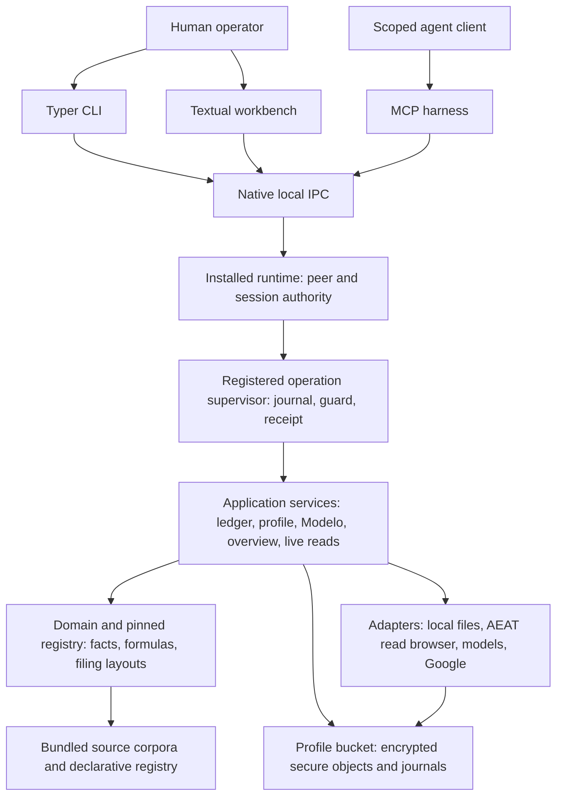
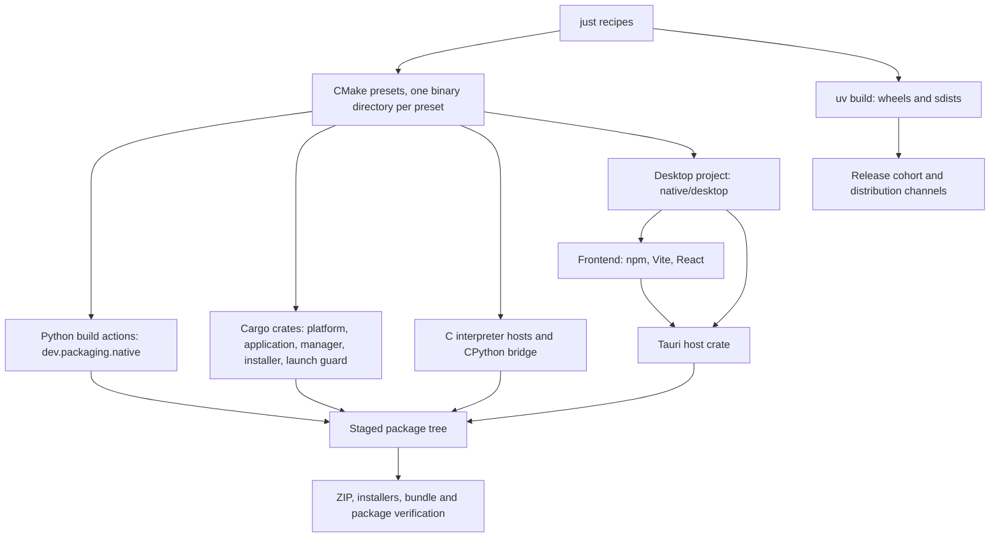

# Cadrumo start

If you are starting or working on this kind of project, context, efficiency, and limiting the actual session context are absolutely critical.

Read these files if the actual task is relevant to you.

Use the reference indexes to select the files relevant to the actual task: the numbered references cover the Python application, the build references cover CMake, Rust, the Tauri desktop shell, the frontend and the Python build, and two cross-cutting references cover the external agent integration and the process environment contract. Do not preload the entire collection. Follow code-source links only when needed to resolve the task's ownership, implementation or verification questions. Scoped findings describe static inspection and require checking against current code before treating them as current defects.

All rules must be respected when working. Selective reading limits session context; it does not exempt work from applicable rules.

## Architecture

## Working rules

The [architecture rule](references/00-architecture.md) uses:

- Import linting: `just check-import-boundaries`.
- Ruff lint and formatting checks: `just check-style` and `just check-format`.
- Type checking: `ty` across `src`, through `just check-types`.
- Strict type checking: `pyrefly` and `basedpyright` over the configured production subset, through the same type runner.
- Relative imports within the actual module/package boundaries, from defining modules, respecting the configured dependency contracts.

Use the repository's configured check scopes. The current commands and checker configuration live in [justfile](../../../justfile) and [pyproject.toml](../../../pyproject.toml).

## Build systems

The Python application above is delivered two ways: as wheels and sdists, and as a native package that bundles CPython, the wheel cohort, the separately built cadrumo-agent wheel, the published registry authority, user documentation, a per-user runtime manager and a Tauri desktop shell. CMake orchestrates the native package and delegates to Python build actions, Cargo and Node. [native/CONTRACT.md](../../../native/CONTRACT.md) is the authored contract for the native build and installed layout.

The diagram shows build hand-offs, not runtime authority. At run time the desktop shell presents and relays, the manager supervises the runtime, and authority stays with the installed runtime as the architecture diagram shows.

Build entry points:

- Environment: `just setup` converges the uv environment; `just init` also installs browsers and search and publishes the registry authority.
- Native package: configure needs the cache variable `CADRUMO_PACKAGE_AGENT_SOURCE_DIR` naming a local cadrumo-agent project folder (the environment is not read). `just build-native [Release|Debug] [TARGET]` (default target `bundle`), `just test-native-bundle`, `just build-native-package`, `just test-native-package`, `just test-native-release`. Each maps the host to a root preset and builds in `build/<preset>`; other binary directory names are refused.
- Rust: no `just` recipe runs cargo, clippy or rustfmt. Build one crate target through CMake, for example `just build-native Release rust_manager`. Crates include generated contract sources, so a bare `cargo` invocation does not compile them.
- Desktop shell: configure `cmake -S native/desktop --preset desktop-windows-x64` (it needs the native contract and a package root), then build targets such as `desktop-host-build`, `desktop-host-test`, `desktop-host-clippy` and `desktop-run`. Packaged-window tests need an interactive desktop session.
- Frontend: `just dev` republishes the registry authority when stale, then serves the frontend in a browser on fixed ports and compiles no Rust. In `native/desktop/frontend`, `npm run check` then `npm test`.
- Python distributions and docs: `just build-distributions`, `just test-packaging-preflight`, `just docs-build`, `just docs-check`.
- Python gates before finishing: `just check-code`, `just check-registry-gate`, `just test-gate`.

Minimum tool versions are declared in [native/toolchain.json](../../../native/toolchain.json); configure refuses anything older and admits newer releases. A local build, package or export is a file on disk: it is not a published release, an installed and working product, or a submission to a tax authority.

| Actual task | Build reference |
|---|---|
| Native presets, CMake targets and modules, toolchain pins, bundle, ZIP, installers and their verification | [build-cmake-and-packaging](references/build-cmake-and-packaging.md) |
| Rust crates under `native/` (application, platform, manager, installer, launch guard) and the C interpreter hosts | [build-rust-native-crates](references/build-rust-native-crates.md) |
| Tauri desktop host: build scripts, configuration, commands, docs scheme, logs, terminal, packaged tests | [build-tauri-desktop-shell](references/build-tauri-desktop-shell.md) |
| Desktop web frontend: stack, npm scripts, Host port and IPC contract, design system, scenarios and Playwright | [build-desktop-frontend](references/build-desktop-frontend.md) |
| `pyproject.toml`, `justfile`, wheel and wheelhouse packaging, Python build actions, docs build, CI and release | [build-python-packaging-and-release](references/build-python-packaging-and-release.md) |
| Packaging, launching and supervising cadrumo-agent: `aeat app agent serve`, hosting frame, provider catalog, credentials, desktop agent host, agent acceptance lanes | [agent-integration](references/agent-integration.md) |
| Process environment: `native/application-environment.toml`, launch profiles and invocations, storage-root precedence, build and development variables | [environment-contract](references/environment-contract.md) |

Cadrumo implements no agent capability. cadrumo-agent is a separate project that alone decides which agents, providers, lanes and models it supports; Cadrumo packages it, launches and supervises it, hands it profile credentials and serves its tools through Cadrumo's MCP relay. Cadrumo records and code make no ruling on agent providers and name none.

The build references are orientation written from static reading of the build sources. They mirror no numbered rule and add no rule authority; where one disagrees with the contract, a CMake refusal or a test, the repository is right. When a build file moves or changes shape, refresh the matching reference and its line anchors.

## Task-relevant references

The numbered references mirror the project rules in [the canonical rules folder](../../rules). When changing a numbered rule, update its matching reference and preserve working source links. These copies are packaged for discovery; they do not create a second rule authority.

| Actual task | Reference |
|---|---|
| Layer placement, cross-layer data flow, authority and code discipline | [00-architecture](references/00-architecture.md) |
| CLI command composition, envelopes and operator-facing policy | [01-operator-interfaces-part-1](references/01-operator-interfaces-part-1.md) |
| CLI-to-worker requests, settlement, secrets and profile edits | [01-operator-interfaces-part-2](references/01-operator-interfaces-part-2.md) |
| Installed runtime, TUI workbench or MCP agent harness | [02-runtime-tui-and-agent-harness](references/02-runtime-tui-and-agent-harness.md) |
| PDF, e-invoice, receipt and financial-file imports | [03-document-and-financial-imports](references/03-document-and-financial-imports.md) |
| Native IPC, AEAT browser, Google or model adapters | [04-external-integrations-and-local-runtime](references/04-external-integrations-and-local-runtime.md) |
| Encrypted persistence, custody, journals and recovery | [05-persistence-and-secure-storage](references/05-persistence-and-secure-storage.md) |
| Application state, diagnostics, provisioning and evidence bundles | [06-application-orchestration-and-diagnostics](references/06-application-orchestration-and-diagnostics.md) |
| Financial aggregation, source resolution and cross-period calculations | [07-aggregation-and-calculation-services](references/07-aggregation-and-calculation-services.md) |
| Authentication sessions, certificates and storage management | [08-authentication-and-storage-management](references/08-authentication-and-storage-management.md) |
| Local filing exports, live capture and receipt promotion | [09-filing-and-live-state](references/09-filing-and-live-state.md) |
| Ledger, invoices, evidence confirmation and prorrata registers | [10-ledger-invoices-and-registers](references/10-ledger-invoices-and-registers.md) |
| Modelo calculation, edits, revisions, export and reconciliation | [11-modelo-work-and-revision-lifecycle-part-1](references/11-modelo-work-and-revision-lifecycle-part-1.md) |
| Modelo addressing, verification, workbench and workspace currentness | [11-modelo-work-and-revision-lifecycle-part-2](references/11-modelo-work-and-revision-lifecycle-part-2.md) |
| Operation supervisor, profiles, read projections and workflows | [12-operations-profiles-and-workflows](references/12-operations-profiles-and-workflows.md) |
| Shared contracts, configuration, provenance and errors | [13-core-authority-and-shared-controls](references/13-core-authority-and-shared-controls.md) |
| Tax registry snapshots, facts, bindings, formulas and layouts | [14-tax-calculation-domain](references/14-tax-calculation-domain.md) |
| Taxpayer, family, business and financial domain records | [15-business-and-taxpayer-domain](references/15-business-and-taxpayer-domain.md) |
| Bundled knowledge, registry data and localization | [16-bundled-knowledge-and-localization](references/16-bundled-knowledge-and-localization.md) |
