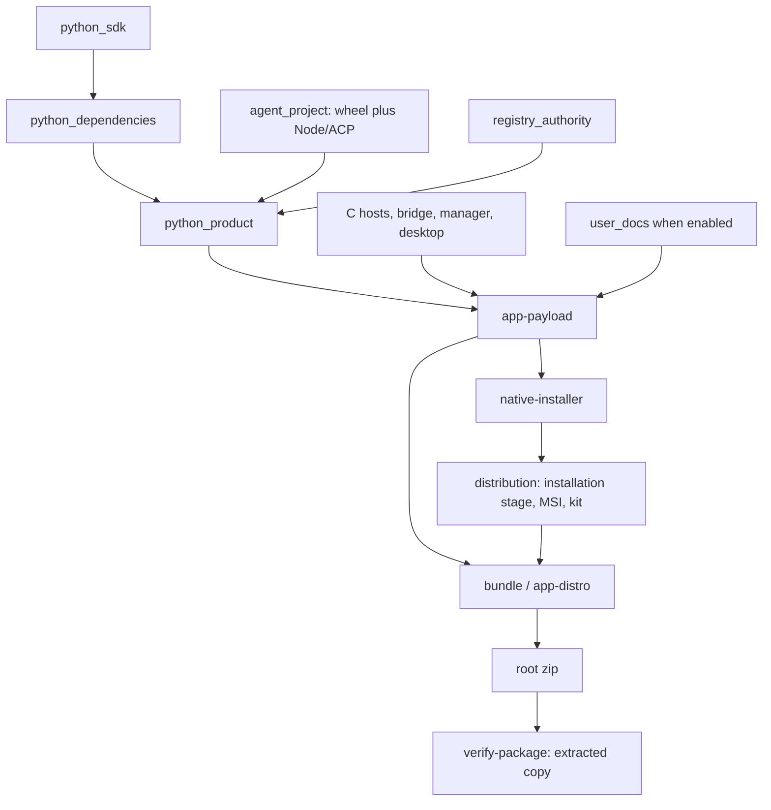

---
tags:
  - '#reference'
  - '#native-build-disk-audit'
date: '2026-10-16'
modified: '2026-10-16'
body_schema: 'body-v2'
body_hash: 'sha256:981f8ec228f556a554221762111c0eb03567fb5cf2986f97f211c5e24a175cd5'
related:
  - "[[2026-10-03-application-packaging-interpreter-foundation-adr]]"
  - "[[2026-10-13-native-agent-adr]]"
  - "[[2026-10-13-package-verification-adr]]"
---

# CMake target, output-directory and disk-operation audit

## Summary

Read-only implementation audit of the root native build, standalone desktop project and distribution project on 2026-10-16. Scope: binaries, Python acquisition/dependencies/wheels, copying, staging, archive construction, temporary work, defaults, names and cleanup. No build, deletion, installation or implementation change was performed for this audit.

Basis: HEAD `7cfbc5463b3b70080a0776ae97ad78aff5997527` plus the dirty working tree. `source-sha256.json` identifies the inspected files; HEAD alone does not contain all current implementation. Semantic discovery covered code and accepted decisions. The related interpreter-foundation, native-agent and package-verification decisions govern this audit; no new binding decision is proposed.

Evidence is in `.tmp/cmake-disk-audit-20261016/`. `directories.csv` lists all 78,394 observed directories, absolute paths, path families, direct/subtree logical sizes and associated cleanup owners. `targets.csv` lists all 515 generated target projects, actual ProjectReference prerequisites and Debug/Release cleanup paths. `presets.json`, `path-verification.json`, `source-sha256.json`, `inventory-summary.json`, build-tree and external-cache `*-du.tsv` files and `timing-evidence.json` support the measurements. The census skipped reparse points and reported no enumeration errors.

Measurements are live, not one atomic snapshot. Another session was compiling the standalone desktop. Earlier allocation scans and later logical census therefore differ. Do not add parent and child rows; independent per-tree allocation totals may count hard links again. Existing timing receipts describe historical inputs, not new benchmarks or current package acceptance.

Main findings: a 69.554 GiB external uv cache with repeatedly expanded companion payloads; destructive full-stage replacement; uncached MSI compilation on the default bundle path; overbroad product snapshots/invalidation; agent wheel/runtime coupling; expensive no-op hashing; replacing test-host source copies; empty clean-app-payload ownership; retained transient installation copies.

## Projects, defaults and names

The three CMakePresets.json files declare 13 configure presets. `native/cmake/BinaryDirectory.cmake:6` enforces repository-root `build/<configure-preset-name>` and rejects another leaf or an enrolled name elsewhere.

| Project | Configure presets, each with default directory build/name |
| --- | --- |
| Root | `windows-x64`, `windows-installers-x64`, `linux-x86-64`, `linux-aarch64`, `macos-arm64` |
| Standalone desktop | `desktop-windows-x64`, `desktop-linux-x86-64`, `desktop-linux-aarch64`, `desktop-macos-arm64` |
| Distribution | `distribution-windows-x64`, `distribution-linux-x86-64`, `distribution-linux-aarch64`, `distribution-macos-arm64` |

All four Windows trees are present and enrolled. `build/acceptance` is present but is test scratch, not an enrolled CMake binary directory.

| Existing enrolled tree | Earlier per-tree allocated size | Later logical census |
| --- | ---: | ---: |
| `build/windows-x64` | 26.403 GiB | 27.130 GiB |
| `build/windows-installers-x64` | 23.256 GiB | 24.349 GiB |
| `build/desktop-windows-x64` | 13.277 GiB | 14.223 GiB |
| `build/distribution-windows-x64` | 6.919 GiB | 6.647 GiB |

The external development cache is larger than any individual binary tree. A separate du pass measured 78.850 GiB across 1,091,445 files: uv 69.554 GiB, pycache 6.838 GiB, Cargo home 0.585 GiB, plus smaller tool and domain caches. The shared frontend node_modules was 0.404 GiB. These external rows are separate from the four build-root measurements. Some cache files have links elsewhere, so this is occupied-tree accounting, not a promise that deleting one subtree reclaims its whole measured size.

Naming verification:

- `windows-x64` is a preset/platform spelling, `windows-x86-64` is the canonical target, and `x86_64-pc-windows-msvc` is the Cargo triple. These are intentional namespaces.
- Root Configurations.cmake admits exactly `Debug` and `Release`; native Cargo maps to `debug` and `release`, with command profile dev selecting debug. Both current source-tree caches have docs OFF, development interpreter inclusion OFF, and build number 1.
- Standalone desktop/distribution caches advertise Debug, Release, MinSizeRel and RelWithDebInfo. The desktop driver supports all four, but the three release-like configurations share Cargo release/ and change its build environment. Their binaries cannot coexist independently at that path. This differs from the root two-configuration contract; it is not an unsupported-profile error (`native/desktop/scripts/configuration.mjs:43`, `native/desktop/CMakeLists.txt:60`).
- Production `python.exe` and optional `python_d.exe` both use the release CPython ABI. The suffix means development host, not Python debug ABI.
- Root ZIP: `packages/<Config>/CADRUMO-<version>-b<build>-windows-x64-<Config>.zip`, with matching top-level directory. Distribution ZIP: `packages/<package-name>-<version>-<canonical-target>.zip`, without configuration. Scoped MSI leaves, such as user-version.msi, are stable role names without version/configuration; manifests and owning trees supply identity (`native/cmake/Packaging.cmake:324`, `native/cmake/CPackProject.cmake.in:1`, `native/cmake/distribution/CMakeLists.txt:77`).
- Target names intentionally mix underscores and hyphens. Layout admits `[A-Za-z0-9_.+-]+`; entrypoint names use lower-case kebab spelling; generated C targets use underscore identifiers. A universal kebab-only rule does not exist (`dev/packaging/native/layout.py:20`, `native/cmake/platforms/Windows.cmake:123`).

## Target graph and output ownership

This is the Windows desktop graph. bundle is ALL; app-distro aliases it; InstallerFlow adds native-installer to bundle. Ordinary builds therefore include more than the application payload. The isolated installer-source preset still packages through shared build/distribution-windows-x64; a lock spans its configure/build to prevent another source tree rebinding that cache concurrently (`native/cmake/Packaging.cmake:185`, `native/cmake/Packaging.cmake:253`, `native/cmake/InstallerFlow.cmake:59`).

| Targets | Result |
| --- | --- |
| `setup-native-builder` | Configure-owned builder, or validation of explicitly external interpreter |
| `native_contract`, `native_metadata` | C/Rust/JSON declarations and image identity resources |
| `python_sdk`, `python_dependencies`, `native_build_tools` | SDK, locked runtime closure, build-only renderer |
| `agent_project` | Private wheel and pinned Node/ACP runtime |
| `python_product` | Complete combined Python closure, four product wheels and snapshot |
| C interpreter/entrypoint/bridge targets | Native bin/lib/symbol outputs by configuration |
| `rust_platform*`, `rust_manager`, `rust_installer`, `rust_launch_guard`, `rust_application` | Cargo artifacts; installer has a further isolated subtree |
| `python`, `python_d` | Interpreter-only package at the SAME stage/Config/app location as the application |
| `app-payload` | Application tree; no services kit by itself |
| `app-native`, `app-agent`, `app-recover` | Existing-stage targeted writes/recovery, no whole Python copy |
| `bundle`, `app-distro`, `agent-install` | Complete delivery including Windows services kit/checks |
| `native-installer` | Configure distribution project on selected payload, build native-package |
| `installation_prepare` | Installation-layout stage, metadata, retained receipts, candidate work |
| `msi*`, `native-package` | Four scoped products, admission checks and adjacent services kit |
| Root/distribution `zip` | Different archives: delivery bundle versus installation layout |
| `verify*`, `release` | Test, extracted ZIP and release aggregates |
| `desktop-*` | Frontend, host snapshots, production/test Cargo, runs and checks |
| `user_docs*` | Build/work/shippable docs; current payloads have docs disabled |
| `agent-lock-*`, `agent-checksum`, `agent-uninstall`, `agent-rebuild` | Explicit dependency maintenance |
| `install-msi`, `remove-msi-version`, `unregister-msi`, `uninstall` | Explicit installation maintenance |
| `clean-<target>` and cleanup groups | Bounded generated-output removal; ownership exceptions below |

Current manifests enumerate 90 non-clean targets in each root-source tree, 33 standalone desktop targets and 12 distribution targets. Including generated clean and Visual Studio utility projects gives 202 + 202 + 75 + 36 = 515. Complete names and actual build prerequisites are in targets.csv; cleanup depends entries are not build prerequisites. ALL_BUILD, ZERO_CHECK, INSTALL, PACKAGE and dashboard projects are generator utilities.

## Every declared directory family

All paths below are relative to the owning binary directory B. A declared family is not necessarily populated by every project. All four generated maps exactly match the 29 authored families, stay below B and have unique exact case-folded paths (`native/cmake/BuildPaths.cmake:10`, `dev/packaging/native/build_paths.py:9`).

| Family | Default path | Producer | Contents |
| --- | --- | --- | --- |
| `agent` | `_deps/agent` | `agent_project` | wheel, Node/ACP runtime, receipts |
| `bin` | `bin` | `C hosts/bridge` | executables and DLLs in Config |
| `cargo` | `cargo/native` | `native Cargo targets` | triple/profile; installer subdirectory |
| `desktop_cache` | `desktop/vite-cache` | `frontend/content-build scripts` | content identities/cache |
| `desktop_cargo` | `cargo/desktop` | `desktop-host-build/test/clippy` | profile outputs and dependency graph |
| `desktop_frontend` | `desktop/frontend` | `desktop-frontend-build` | compiled assets |
| `desktop_frontend_generated` | `desktop/frontend-generated` | `desktop-frontend-chrome/palette` | generated locale/palette files |
| `desktop_host` | `desktop/host` | `backend source snapshot` | copied crates and generated config |
| `desktop_icons` | `desktop/icons` | `desktop-host-prepare/build` | generated icons |
| `desktop_results` | `desktop/test-results` | `frontend/window tests` | screenshots and results |
| `desktop_testing` | `desktop/testing` | `desktop packaged/backend tests` | isolated host/cargo/state |
| `generated` | `generated` | `native_contract/native_metadata + configure` | shared declarations, identities, receipts |
| `installation_metadata` | `installation/metadata` | `installation_prepare/msi-author` | inventory, WiX, maintenance metadata |
| `installation_receipts` | `installation/receipts` | `distribution refresh/install` | retained content-addressed owning receipts |
| `installation_stage` | `installation/stage` | `installation_prepare` | versioned installation layout |
| `installation_work` | `installation/work` | `installation_prepare` | temporary candidate installations |
| `lib` | `lib` | `C/bridge link outputs` | archives/import libraries in Config |
| `packages` | `packages` | `zip/msi` | Config ZIPs; distribution msi and compile scratch |
| `product` | `product` | `python_product` | dependencies plus build/source and build/wheels |
| `python_sdk` | `_deps/python-sdk` | `python_sdk` | archive and expanded SDK |
| `runtime` | `_deps/runtime` | `python_dependencies` | locked installed base closure |
| `stage` | `stage` | `app-payload/python/python_d/native-installer` | Config/app, ready, adjacent services |
| `symbols` | `symbols` | `compiler/linker` | PDBs in Config |
| `testing` | `testing` | `CTest/native tests/agent-lock-*` | test state and lock work |
| `tools` | `_deps/build-tools` | `native_build_tools` | build-only SVG renderer |
| `user_docs_build` | `user-docs/build` | `user_docs_build` | compiled sites |
| `user_docs_stage` | `user-docs/stage` | `user_docs_stage` | shippable docs and delegated manifest |
| `user_docs_work` | `user-docs/work` | `user_docs_build/verification` | private docs work/storage |
| `verification` | `verification` | `verify-package` | Config extraction/state/results |

Other declared/tool-managed locations:

| Location | Owner and default behavior |
| --- | --- |
| `B/_deps/builder` | Bootstrap configure/setup; roughly 1.44-1.46 GiB per measured tree, potentially hard-linked by uv. Explicit clean-setup-native-builder; retained by ordinary output cleanup |
| `B/tmp` | Preset-scoped compiler/MSBuild scratch, intentionally retained during cleanup under MSBuild |
| `B/timings`, `B/.<action>.lock` | Timing receipts and OS-held action locks; no timing retention bound observed |
| `B/install` | Root/distribution default installation prefix, not generated-output cleanup. Standalone desktop retains the generator's unused Program Files install-prefix default |
| `B/CMakeFiles`, `B/native`, `B/x64`, target .dir directories, project/cache files | Generator intermediates, native subprojects and compiler objects; not rogue configure trees |
| `B/Testing` | CTest spelling; Windows aliases testing case-insensitively, POSIX may keep both |
| CPack `_CPack_Packages` directories | Private install/archive scratch when populated |
| `native/desktop/frontend/node_modules` | Shared source-adjacent install across all binary directories; lock-aware frontend-install avoids unconditional npm ci |
| `.authority` | Shared published registry; copied into snapshot/wheel, moved within the new application |
| `var/storage/tmp` | Canonical Python helper temporary root by development default, distinct from compiler B/tmp |
| `var/storage/development/cache/{uv,cargo,npm,pycache,tools,...}` plus development Python/tools/config/data/state | Canonical external tool storage. Cargo target outputs are overridden to B/cargo/native; download/home caches remain outside B |

cmake_build explicitly overrides inherited TEMP/TMP/TMPDIR using prepare_temporary_directory (`dev/packaging/native/cmake_build.py:206`, `src/cadrumo/core/storage_environment.py:656`). Canonical operator overrides can relocate these roots. Inspecting build/ alone therefore cannot account for all build-related disk use.

## Copying, transient staging and publication

| Operation | Source -> destination | Work / lifetime |
| --- | --- | --- |
| SDK | Network -> `_deps/python-sdk/python.<pin>.nupkg` -> `cpython-nuget/tools` | Both archive and expanded SDK retained; CMake passes separate SDK to runtime provisioning |
| Dependencies | Wheel URLs/uv cache -> `_deps/runtime/dependencies` | Two hash-required copy-mode installs; matching overlap does not mean two installed copies |
| Product | runtime/dependencies -> product/dependencies | Full copytree on product miss, then four source-built wheels and agent wheel installed in copy mode |
| Product source | Repository census -> product/build/source plus .authority | Retains non-wheel tests, docs, tooling and vault too; wheels retained in build/wheels |
| Agent runtime | Source package metadata + Node archive/npm ci -> `.agent-runtime-*/runtime` -> runtime | Candidate promotion is rename; Windows initially expands whole upstream Node ZIP |
| Full application | product/dependencies -> stage/Config/app/cadrumo/site-packages | Deletes old configuration stage, copies closure, relocates/adapts, compiles bytecode, inventories |
| Authority | Copied wheel authority -> app/data/authority | Move within new app; not another authority compilation |
| app-native/app-agent | Changed images/wheel members -> existing app | Targeted writes; agent rollback holds changed old bytes in memory; `.native-update-*` publishes manifest with replace |
| Desktop snapshot | Five related Rust crates -> desktop/host | Production uses incremental content sync; packaged test host replaces source copies |
| Desktop test host | Isolated snapshot -> desktop/testing/{packaged,served}/cargo | Remote-debugging feature variant never shipped; separate Cargo outputs are intentional |
| Distribution refresh | app -> installation/work/tmp*/stage -> installation/stage | Copy candidate once, validate, remove previous, replace directory; promotion is NOT a second payload copy |
| Direct installation.prepare reuse | app -> candidate when existing stage requested | Builds candidate to compare receipts; normal CMake refresh passes a fresh candidate, so do not multiply this branch into MSI hot path |
| MSI | installation stage -> packages/msi/compile-* -> final products | Compile/decompile/admit four products, replace final files; temporary context normally cleans |
| Services kit | MSI/runner -> services/kit-UUID -> final members | Copy/hash/replace; equal bytes intentionally replaced to repair inherited permissions; finally removes kit scratch |
| CPack | Install rules -> private CPack stage -> archive | Required archive representation; Windows root ZIP includes app plus two payload-bearing version MSIs and small registration MSIs |
| ZIP verification | ZIP -> verification/Config/ZIP espacio á 漢字 | Retained full extraction, independent state/external-bin and result.json |

Locators: `dev/packaging/native/cmake_build.py:398`, `dev/packaging/native/assemble.py:292`, `dev/packaging/native/agent_runtime.py:77`, `dev/packaging/native/distribution_prepare.py:16`, `dev/packaging/native/windows_msi_build.py:130`, `dev/packaging/native/windows_msi_build.py:288`, `dev/packaging/native/artifact_verify.py:41`.

## Findings and opportunities

### F11 | high operational priority | Repeated companion payloads accumulate outside CMake cleanup

The canonical uv cache occupies 69.554 GiB and contains 722 archive directories. There are 345 cached Cadrumo distribution trees under current version labels. Each of the three 0.6.0 companion distributions has 71 trees with exactly ONE distinct RECORD hash, or 70 repeated recorded payload manifests per companion. The main cadrumo wheel has 95 trees with 69 RECORD hashes; cadrumo-agent has 37 with 33. Across these groups, 240 trees exceed one per distinct RECORD. This is stronger evidence than matching version names alone (`uv-archive-census.json`, `uv-record-duplication.json`).

For the largest recorded member of each companion, the 71 cache instances have 71 distinct file IDs: these representatives are separate file allocations, not one shared hard link. Some individual allocations also have additional links elsewhere. Actual contents of every cached payload were not rehashed; the duplicate-content comparison uses recorded wheel manifests (`uv-duplicate-file-identity.json`).

The build repeatedly rebuilds/reinstalls all companion wheels on product misses while retaining uv's local-wheel cache. That producer granularity and unmanaged cache retention amplify disk use. CMake clean-product/dependencies/all operates inside the owning binary directory and does not own this shared canonical tool cache. Prefer stable companion-wheel reuse and an explicit, lock-aware uv cache lifecycle. Do not delete cache internals around uv locks or assume every archive is stale. Python bytecode caches add another 6.838 GiB and 422,855 files outside build/.

### F01 | high | Full assembly erases the previous package before validating its replacement

build_action resets all stage/Config before calling assemble. Only then are closure checks and copying performed. Bad inputs, sharing violations or disk exhaustion can leave no previous complete app and a partial new stage; the adjacent services kit is deleted too. Receipts fail closed but do not preserve availability (`dev/packaging/native/cmake_build.py:439`, `dev/packaging/native/cmake_build.py:78`, `dev/packaging/native/assemble.py:198`). Earlier disk-full/sharing failures fit this mechanism; this audit injected none.

Improve prerequisite/space admission before reset. Evaluate bounded candidate assembly and promotion while keeping the exact final path. Budget old+candidate peak space: another blind copy would worsen disk exhaustion. Preserve strict recovery and receipts.

### F02 | medium | Unchanged default bundles still compile installers

bundle reaches native-installer, which always configures/builds distribution. Its msi custom target is unconditional. compile_products deletes the prior receipt and compiles/decompiles all four products without checking content currency first (`native/cmake/InstallerFlow.cmake:69`, `native/cmake/InstallerFlow.cmake:97`, `native/cmake/distribution/CMakeLists.txt:233`, `dev/packaging/native/windows_msi_build.py:140`). The measured Release kit's two version MSIs were 369.17 and 366.22 MiB, in addition to the app tree; two registration MSIs were 1.79 MiB each.

Introduce content-bound compilation reuse keyed by verified payload, authoring, tools and adapter/runner bytes. Retain required validation/campaigns. app-payload already selects payload-only production. Removing kit delivery from bundle would change an accepted commitment and is not authorized by this audit.

### F03 | medium | Product misses copy excessive source and rebuild the whole wheel cohort

A miss resets product, copies the base closure, snapshots the repository census, builds all four wheels and reinstalls the combined closure. The filtered CMake wheel inputs do not constrain files copied by snapshot (`dev/packaging/native/product.py:109`, `dev/packaging/native/product.py:144`, `dev/packaging/native/product.py:210`, `dev/packaging/native/cmake_build.py:398`). Each source snapshot measured about 1.131 GiB, including vault 34 MiB, dev 51 MiB and docs 22 MiB. Non-shipping tests are copied despite not driving the fingerprint. A recorded product build spent 107.8 seconds snapshotting out of 515.5 seconds total.

Narrow snapshot membership to declared build-required inputs, including normalization/ignore/attribute owners. Cache immutable companion wheels separately from application code and third-party closure. Keep source-coherence and exact cohort admission. Relocation inputs must not be shared through unsafe writable hard links.

### F04 | medium | Python agent edits rebuild the unchanged Node/ACP runtime

agent_project has one source/runtime identity. A miss resets all _deps/agent, builds the Python wheel, downloads Node and runs npm ci (`native/cmake/Agent.cmake:15`, `dev/packaging/native/cmake_build.py:344`, `dev/packaging/native/agent_runtime.py:77`). Python-only edits therefore repeat unrelated Node/runtime acquisition. Windows expands the complete upstream ZIP only to retain executable/license; the tar path selects required members (`dev/packaging/native/agent_runtime.py:373`).

Split wheel/runtime fingerprints and sub-owners under existing paths. Reuse runtime by Node pin, target, lock and admitted tools. Selectively extract reviewed Windows members with existing traversal/size/hash controls. app-agent avoids whole-app copying but its prerequisite still pays the coupled producer cost.

### F05 | medium | No-op builds repeatedly hash large trees

Shared action staleness and cached-command inventories recursively read file bytes; successful misses rehash inputs and outputs. Historical cache hits: product 30.943 seconds including 27.420 output-inventory seconds; bundle 44.922 including 17.308 input-inventory and 27.541 output-inventory seconds. Another runtime reuse spent 24.532 seconds on output inventory (`dev/packaging/native/action_cache.py:101`, `dev/packaging/native/cached_command.py:23`, `dev/packaging/native/cached_command.py:87`).

Reduce overlapping ownership/inventory passes and reuse verified producer digests at controlled immutable boundaries. Preserve membership/content/tamper and failed-receipt detection; timestamps alone are not equivalent. These timings show inspection overhead, not repeated compilation.

### F06 | medium | Packaged desktop test builds rewrite unchanged source

Production requests incremental sync; packaged host calls snapshotHostSources without the option. The default deletes source directories and copies them again. An always-run custom target can dirty unchanged Rust timestamps and trigger avoidable Cargo work (`native/desktop/scripts/tauri.mjs:79`, `native/desktop/tests/packaged/host.mjs:128`, `native/desktop/scripts/backend-snapshot.mjs:94`, `native/desktop/CMakeLists.txt:297`).

Use the existing content-aware sync, retaining stale-module removal, for this isolated test snapshot. Keep feature-isolated Cargo output; merging the debug-enabled test binary into shipped artifacts is not equivalent.

### F07 | medium | clean-app-payload has no ownership

The cached assembler command is named bundle, so its app, ready and marker ownership attaches to bundle. app-payload invokes it without cleanup enrollment. Both current root-source ownership manifests contain app-payload with empty paths and depends (`native/cmake/Packaging.cmake:165`, `native/cmake/Packaging.cmake:188`, `native/cmake/CachedCommand.cmake:31`, `native/cmake/Cleanup.cmake:76`). clean-bundle and clean-stage have real ownership; clean-app-payload does nothing.

Reconcile producer/alias cleanup ownership without moving final paths or deleting shared prerequisites.

### F08 | medium | Retained interrupted staging consumes several GiB

installation/work retained three tmp candidates: 1.389, 1.153 and 1.221 GiB logical, approximately 3.88 GiB allocated in the earlier scan. packages/msi retained compile-* containing an additional product set. No distribution CMake/WiX producer was observed in the process check. Ordinary TemporaryDirectory/finally cleanup is present; abrupt termination can bypass it (`dev/packaging/native/distribution_prepare.py:26`, `dev/packaging/native/windows_msi_build.py:153`). These are candidate abandoned artifacts, not evidence of a normal-success leak.

Expose bounded stale-work inspection/cleanup with lock, process and ownership checks; retain live candidates and evidence. clean-installation_prepare owns stage/metadata/work. clean-all additionally reads target manifests, so installation outputs ARE included even without a separate group. Owning receipts and managed builder are intentionally retained. Do not clear work during active packaging.

### F09 | opportunity | Common Python bytes are repeated across configurations

Current manifests record 38,246 identical hashes among 38,297 shared member names: approximately 1.257 GiB logical. python.zip has the same recorded hash. Full assembly copies and byte-compiles the common closure independently (`dev/packaging/native/stdlib.py:19`, `dev/packaging/native/assemble.py:292`). This measures reusable work, not safe writable-file sharing between complete native packages.

Evaluate a verified immutable Python layer and post-adaptation bytecode cache, preserving separate native images and manifests. No path change is implemented.

### F10 | opportunity | Additional producers and profile aliases broaden iteration scope

app-payload depends on rust_application, described as a test-consumer rlib never shipped. Root ALL also includes test/native aggregates. Manager/desktop can reuse some compilation, so target invocations are not independent full rebuilds (`native/cmake/Packaging.cmake:201`, `native/application/CMakeLists.txt:26`). Standalone release-like configurations share one release directory as noted above. Measure real dependency changes before pruning these graphs.

### F12 | low | Loose binary test copies have unresolved output ownership

Two directories, `build/windows-installers-x64/cli-host-input-api-agent-source-cbdk3f_5` and `build/windows-installers-x64/cli-host-input-api-agent-source-jcn9rwse`, contain seven copied interpreter/entrypoint/bridge binaries each. They are not registered build-path families or generator directories. A current source producer was not located in the inspected native/dev/agent source search. Record them as unresolved test/scratch ownership, not enrolled configure roots or automatically safe cleanup. They are included in directories.csv.

## Intentional copies and verification boundaries

Enrolled source, installer-source and standalone desktop trees are valid defaults. Native versus desktop Cargo roots are isolated deliberately. Installer Cargo needs another subtree because direct cdylib/rlib builds otherwise collide (`native/cmake/Installer.cmake:8`). Remote-debugging test hosts differ from production. A validated installation candidate, scoped user/machine products, delegated docs stage, CPack stage and extracted verification tree have distinct purposes; overlapping bytes alone do not establish waste.

Full application assembly currently writes the final app after reset: it has no second transactional app directory. Distribution candidate and agent-runtime publication use rename/replace, not a second full-tree copy at promotion. Native/agent incremental updates already avoid complete restaging. SDK/dependency producers are shared across Debug/Release within one binary tree, rather than provisioned once per configuration.

Verification: source/generated path parity, bounded/unique names, preset enrollment, cache options, project references, cleanup ownership and complete metadata census. Existing timing receipts and manifest hashes were reused. No new runtime/package acceptance was executed. First address shared cache growth, producer reuse, ownership and stale work, agent producer separation and test-host sync; then snapshot scope, installer reuse and redundant hashing. Assess transactional publication together with peak-space budget. Immutable layer sharing requires a grounded implementation plan and decision-coverage assessment, not ad hoc moves.

## Complete non-clean target names

Generated clean counterparts and Visual Studio utility projects are all listed in targets.csv. These complete ownership-manifest names supplement the role map; actual build prerequisites are in the CSV.

### windows-x64 (90 targets)

`Continuous`, `Experimental`, `Nightly`, `NightlyMemoryCheck`, `agent-checksum`, `agent-install`, `agent-lock-linux-aarch64`, `agent-lock-linux-x86-64`, `agent-lock-macos-arm64`, `agent-lock-windows-x86-64`, `agent-rebuild`, `agent-uninstall`, `agent_project`, `app-agent`, `app-distro`, `app-native`, `app-payload`, `app-recover`, `bundle`, `cadrumo_bundled_cadrumo_agent`, `cadrumo_entrypoint_aeat`, `cadrumo_entrypoint_cadrumo_agent_service`, `cadrumo_entrypoint_cadrumo_mcp`, `cadrumo_entrypoint_cadrumo_runtime`, `cadrumo_python`, `cadrumo_python_bridge`, `cadrumo_python_d`, `check_installer`, `check_manager_lifecycle`, `desktop-build-test`, `desktop-configuration-test`, `desktop-frontend-build`, `desktop-frontend-check`, `desktop-frontend-chrome`, `desktop-frontend-generated`, `desktop-frontend-install`, `desktop-frontend-palette`, `desktop-frontend-test`, `desktop-headless-test`, `desktop-host-build`, `desktop-host-clippy`, `desktop-host-prepare`, `desktop-host-test`, `desktop-host-unit-clippy`, `desktop-host-unit-test`, `desktop-packaged-harness-test`, `desktop-packaged-host`, `desktop-packaged-test`, `desktop-paths-test`, `desktop-run`, `desktop-startup-test`, `native-installer`, `native-process-quiesce`, `native_build_tools`, `native_contract`, `native_metadata`, `platform_dll_consumer`, `platform_static_consumer`, `platform_test_binaries`, `python`, `python_d`, `python_dependencies`, `python_product`, `python_sdk`, `registry_authority`, `registry_authority_rebuild`, `release`, `rust_application`, `rust_installer`, `rust_launch_guard`, `rust_manager`, `rust_manager_lifecycle`, `rust_platform`, `rust_platform_consumer`, `rust_platform_shared`, `rust_platform_static`, `setup-native-builder`, `user_docs`, `user_docs_build`, `user_docs_driver_test`, `user_docs_sequences_check`, `user_docs_sequences_refresh`, `user_docs_stage`, `user_docs_verify`, `verify`, `verify-app-distro`, `verify-native-live`, `verify-package`, `verify-release`, `zip`.

### windows-installers-x64 (90 targets)

`Continuous`, `Experimental`, `Nightly`, `NightlyMemoryCheck`, `agent-checksum`, `agent-install`, `agent-lock-linux-aarch64`, `agent-lock-linux-x86-64`, `agent-lock-macos-arm64`, `agent-lock-windows-x86-64`, `agent-rebuild`, `agent-uninstall`, `agent_project`, `app-agent`, `app-distro`, `app-native`, `app-payload`, `app-recover`, `bundle`, `cadrumo_bundled_cadrumo_agent`, `cadrumo_entrypoint_aeat`, `cadrumo_entrypoint_cadrumo_agent_service`, `cadrumo_entrypoint_cadrumo_mcp`, `cadrumo_entrypoint_cadrumo_runtime`, `cadrumo_python`, `cadrumo_python_bridge`, `cadrumo_python_d`, `check_installer`, `check_manager_lifecycle`, `desktop-build-test`, `desktop-configuration-test`, `desktop-frontend-build`, `desktop-frontend-check`, `desktop-frontend-chrome`, `desktop-frontend-generated`, `desktop-frontend-install`, `desktop-frontend-palette`, `desktop-frontend-test`, `desktop-headless-test`, `desktop-host-build`, `desktop-host-clippy`, `desktop-host-prepare`, `desktop-host-test`, `desktop-host-unit-clippy`, `desktop-host-unit-test`, `desktop-packaged-harness-test`, `desktop-packaged-host`, `desktop-packaged-test`, `desktop-paths-test`, `desktop-run`, `desktop-startup-test`, `native-installer`, `native-process-quiesce`, `native_build_tools`, `native_contract`, `native_metadata`, `platform_dll_consumer`, `platform_static_consumer`, `platform_test_binaries`, `python`, `python_d`, `python_dependencies`, `python_product`, `python_sdk`, `registry_authority`, `registry_authority_rebuild`, `release`, `rust_application`, `rust_installer`, `rust_launch_guard`, `rust_manager`, `rust_manager_lifecycle`, `rust_platform`, `rust_platform_consumer`, `rust_platform_shared`, `rust_platform_static`, `setup-native-builder`, `user_docs`, `user_docs_build`, `user_docs_driver_test`, `user_docs_sequences_check`, `user_docs_sequences_refresh`, `user_docs_stage`, `user_docs_verify`, `verify`, `verify-app-distro`, `verify-native-live`, `verify-package`, `verify-release`, `zip`.

### desktop-windows-x64 (33 targets)

`desktop-build-test`, `desktop-configuration-test`, `desktop-frontend-build`, `desktop-frontend-check`, `desktop-frontend-chrome`, `desktop-frontend-generated`, `desktop-frontend-install`, `desktop-frontend-palette`, `desktop-frontend-test`, `desktop-headless-test`, `desktop-host-build`, `desktop-host-clippy`, `desktop-host-prepare`, `desktop-host-test`, `desktop-host-unit-clippy`, `desktop-host-unit-test`, `desktop-packaged-harness-test`, `desktop-packaged-host`, `desktop-packaged-test`, `desktop-paths-test`, `desktop-run`, `desktop-startup-test`, `native_contract`, `registry_authority`, `registry_authority_rebuild`, `setup-native-builder`, `user_docs`, `user_docs_build`, `user_docs_driver_test`, `user_docs_sequences_check`, `user_docs_sequences_refresh`, `user_docs_stage`, `user_docs_verify`.

### distribution-windows-x64 (12 targets)

`install-msi`, `installation_prepare`, `msi`, `msi-author`, `msi-bootstrap-kit`, `msi-verify`, `native-package`, `remove-msi-version`, `setup-native-builder`, `uninstall`, `unregister-msi`, `zip`.
